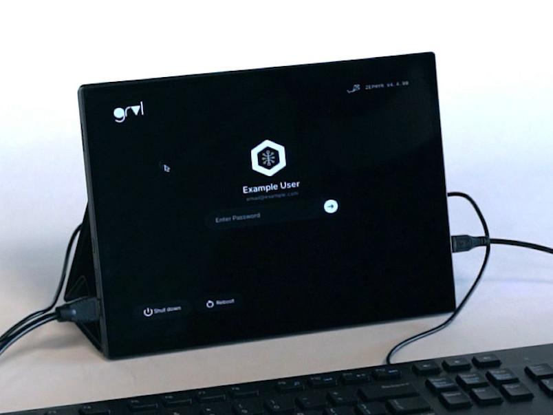

# Zephyr GRVL Greeter Sample

Copyright (c) 2026 Antmicro

This repository includes an interactive greeter login screen demo using [Graphics Rendering Visual Library](https://github.com/antmicro/grvl) and [Zephyr RTOS](https://zephyrproject.org).



The correct password is stored in `app/romfs/callbacks.js` in the `CORRECT_PASSWORD` constant.
By default it is `Password`.

## Features

- Buttons (Shutdown, Reboot, right arrow)
- Password input field
- Keyboard and mouse support with cursor

## Supported boards

- [STM32H7 HDMI board](https://docs.zephyrproject.org/latest/boards/antmicro/stm32h7_hdmi_board/doc/index.html)

## Building

Set up the workspace:
```
$ mkdir zephyr-workspace
$ cd zephyr-workspace
$ python -m venv .venv
$ source .venv/bin/activate
$ pip install west jsonschema pyelftools
```

Build:
```
$ git clone https://github.com/antmicro/grvl-zephyr-greeter-demo.git
$ cd grvl-zephyr-greeter-demo
$ west init -l .
$ west update
$ west patch apply
$ west build -b stm32h747i_disco/stm32h747xx/m7 app
```

To flash the freshly built binaries execute the [flashing steps](#flashing-the-binaries).

## Flashing the binaries

Connect to the STM32H7 HDMI Board via a USB-C port labeled `USB PD`.

```
# openocd -f ft4232hpq-swd.cfg -f target/stm32h7x_dual_bank.cfg -c "init; program build/zephyr/zephyr.elf verify reset exit"
```

Now, connect a microSD card and replace `<name>` below with the actual SD card's device file name.
```
# dd if=build/zephyr/zephyr.sdcard.img of=/dev/<name> bs=4M
```

## License

The source code for this project is licensed under [Apache License 2.0](https://www.apache.org/licenses/LICENSE-2.0),
and the fonts are licensed under [SIL Open Font License 1.1](https://openfontlicense.org).
